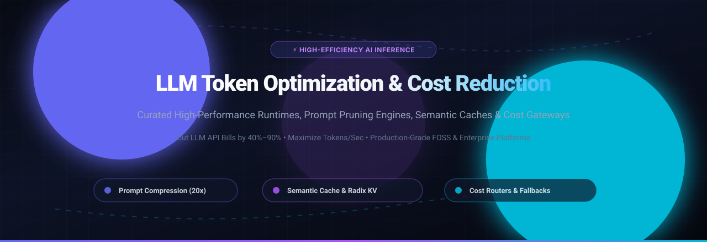

  

# 🚀 Awesome LLM Token Optimization & Cost Reduction 💰

  
  
  
  
  
  

> **The definitive production guide and curated index for LLM token optimization, prompt compression algorithms, KV-cache acceleration, semantic caching layers, and intelligent cost-routing proxies.** Slash your OpenAI, Anthropic, and open-weights inference expenses by 40%–90% while improving throughput and p99 latency. 🌟 Star if you find this valuable! 🌟

---

## 📑 Table of Contents

- [📊 Sector Overview & Market Dynamics](#-sector-overview--market-dynamics)
- [🏢 SaaS & Hosted Commercial Platforms](#-saas--hosted-commercial-platforms)
- [🛠️ Open-Source Ecosystem & Tools](#️-open-source-ecosystem--tools)
  - [🗜️ Prompt Compression, Pruning & Token Reduction Engines](#️-prompt-compression-pruning--token-reduction-engines)
  - [⚡ Semantic Caching & KV-Cache Reuse Frameworks](#-semantic-caching--kv-cache-reuse-frameworks)
  - [🎯 Cost-Aware Model Routers & Budget-Enforcing Gateways](#-cost-aware-model-routers--budget-enforcing-gateways)
  - [🧠 Inference-Time Compute & Multi-Strategy Optimization Proxies](#-inference-time-compute--multi-strategy-optimization-proxies)
  - [🚀 High-Throughput Token Serving & Structured Output Engines](#-high-throughput-token-serving--structured-output-engines)
- [📈 Star History](#-star-history)
- [💖 Support & Sponsorship](#-support--sponsorship)
- [🤝 Contributing](#-contributing)

---

## 📊 Sector Overview & Market Dynamics

The global **AI inference and token optimization market** is projected to expand from **~$106 billion in 2025 to over $310 billion by 2030** (CAGR ~18%), as production enterprise spend irreversibly pivots from model training to inference-dominated multi-agent workloads. 

The sector exhibits **moderate fragmentation across specialized layers** (semantic vector caching, dynamic context-pruning, model routing proxies), but **high concentration in raw token-serving silicon and neocloud infrastructure** where massive wafer-scale capital expenditures create strong economies of scale and winner-take-most dynamics.

---

## 🏢 SaaS & Hosted Commercial Platforms

Below is a breakdown of commercial inference accelerators, managed routing proxies, and enterprise AI gateways, sorted descending by corporate scale (market capitalization, recent valuation, or verified revenue run rate):

| Product / Platform | Company Scale (Valuation / Revenue) | Starting Tier Pricing | Free Tier / Trial Limits | Core Cost-Optimization Features |
| :--- | :--- | :--- | :--- | :--- |
| **[Cloudflare AI Gateway](https://cloudflare.com)** | **$101.5B Market Cap** (~$2.51B TTM Rev) | **$0 / month** (Gateway core is free; Workers Paid starts at **$5/mo**) | **100,000 logs/day free forever**; free semantic response caching & request deduplication | Edge-proxied response caching, rate limiting, and request deduplication to intercept identical LLM calls before hitting upstream APIs. |
| **[Cerebras Inference Cloud](https://cerebras.ai)** | **$26.0B Valuation** (~$960M 2026E Rev) | **$0.10 / 1M tokens** (Llama-3.1 8B) / $0.35 in & $0.75 out per 1M (GPT-OSS 120B) | **1,000,000 tokens/day free forever** (no credit card required) + $5 promo credit (30 days) | Wafer-Scale Engine (CS-3) architecture delivering world-record token generation speeds and ultra-low per-token costs. |
| **[Fireworks AI](https://fireworks.ai)** | **$17.5B Valuation** (~$1.0B ARR) | **$0.20 / 1M tokens** (Standard serverless models) | **$1.00 one-time starter credit** upon signup (no permanent free tier; pay-as-you-go thereafter) | Custom CUDA kernels, LoRA parameter packing, prompt caching, and speculative decoding to minimize serving overhead. |
| **[SambaNova Cloud](https://sambanova.ai)** | **$11.0B Valuation** (~$100M ARR) | **$0.22 in / $0.59 out per 1M tokens** (gpt-oss-120b) | **Free Developer Sandbox** capped at strict RPM/RPD limits (~$5 signup evaluation credit) | Proprietary Reconfigurable Dataflow Units (RDUs) optimized for large-context token throughput and low latency. |
| **[Together Turbo (Together AI)](https://together.ai)** | **$8.3B Valuation** (~$1.15B ARR) | **$0.15 / 1M tokens** (Serverless entry models; $15 minimum initial deposit) | **No permanent free tier**; requires $15 initial deposit to fund evaluation and API usage | FP8 hardware quantization, FlashAttention-3, speculative decoding, and up to 50% discount on Batch API workloads. |
| **[DeepSeek API](https://deepseek.com)** | **$5.0B+ Est. Valuation** (High-Flyer Capital) | **$0.15 in (cache miss) / $0.003 in (cache hit)** / $0.60 out per 1M tokens (Off-peak) | **Free web/app access**; introductory free trial tokens upon API registration, pay-as-you-go thereafter | Multi-Head Latent Attention (MLA) and DeepSeek-V3 MoE architecture with automated context caching slashing input rates by up to 98%. |
| **[GroqCloud](https://groq.com)** | **$3.5B Valuation** (~$500M Proj. Rev) | **$0.05 / 1M tokens** (Llama 3.1 8B Developer Tier pay-as-you-go) | **30 RPM / 1,000 RPD / 200,000 tokens/day free forever** (Developer Free Plan, no card required) | Language Processing Units (LPUs) delivering deterministic, ultra-fast token streaming and cost efficiency for open weights. |
| **[Martian](https://withmartian.com)** | **$1.3B Valuation** ($30M+ VC funding) | **Pay-as-you-go per routed token** (~$0.001 per 1k tokens routed + provider cost) | **Custom trial access via developer onboarding** (no public unmetered free tier) | Dynamic "Model Mapping" router automatically offloading simple requests to smaller models while routing hard queries to frontier LLMs. |
| **[OpenRouter](https://openrouter.ai)** | **$1.3B Valuation** (~$150M ARR) | **5.5% routing fee** over provider token rates (Pay-as-you-go) | **20 RPM & 50 requests/day free forever** across `:free` models (scales to 1,000 RPD with $10 credit purchase) | Unified multi-provider proxy with intelligent failover, load balancing, prompt prefix caching, and zero-markup free models. |
| **[Portkey](https://portkey.ai)** | **$117M Acquisition** (Palo Alto Networks) | **$9.00 / month** (Pro Tier starting pack with overage allowances) | **10,000 requests/month free forever** (Dev Plan with full tracing & gateway features) | Enterprise AI gateway providing semantic vector caching, dynamic fallbacks, latency-based routing, and budget limits per user/key. |
| **[PromptLayer](https://promptlayer.com)** | **$4.8M Seed Funded** (~$1M ARR) | **$49.00 / month** (Pro Plan base subscription) | **2,500 requests/month free forever** (Dev Plan with 10 prompts and 250 evaluation executions) | Prompt lifecycle analytics, token spend tracking per request/version, and prompt refinement tools to reduce verbose instructions. |

---

## 🛠️ Open-Source Ecosystem & Tools

Explore the leading open-source software libraries, serving engines, routers, and compressors. **Each section is sorted descending by GitHub stargazers count** to highlight community adoption.

---

### 🗜️ Prompt Compression, Pruning & Token Reduction Engines

Reduce token consumption before queries hit LLM inference endpoints through algorithmic pruning, prompt compilation, and syntactic data serialization.

* **[TOON (Token-Oriented Object Notation)](https://github.com/toon-format/toon)**  — Compact human-readable serialization format designed specifically to replace JSON in LLM prompts, eliminating structural token overhead by 30%–60%.
* **[LLM Cookbook Recipes](https://github.com/meta-llama/llama-cookbook)**  — Official Meta repository featuring prompt optimization, quantization scripts, memory compaction, and token-saving patterns for Llama models.
* **[LLMLingua & LongLLMLingua (Microsoft)](https://github.com/microsoft/LLMLingua)**  — Research-backed prompt compression engine achieving up to 20x token reduction across RAG, long-context reasoning, and multi-turn dialogues with minimal perplexity degradation.
* **[AutoGPTQ](https://github.com/AutoGPTQ/AutoGPTQ)**  — 4-bit quantization package with fast GPU kernels, shrinking weights to enable smaller GPU footprints and higher token concurrency.
* **[AutoAWQ](https://github.com/casper-hansen/AutoAWQ)**  — Activation-aware Weight Quantization (AWQ) toolkit providing 2x–3x faster token generation speeds and 70% VRAM memory savings.
* **[Selective Context](https://github.com/liyucheng09/Selective_Context)**  — Official implementation of EMNLP paper compressing context via self-information filtering of uninformative lexical units.

---

### ⚡ Semantic Caching & KV-Cache Reuse Frameworks

Avoid redundant LLM token charges by retrieving cached answers via vector similarity and reusing precomputed attention matrices across prompt prefixes.

* **[SGLang (RadixAttention)](https://github.com/sgl-project/sglang)**  — Ultra-high-throughput serving runtime with automatic tree-structured RadixAttention KV-cache sharing across complex multi-turn chats and agentic workflows.
* **[LMCache](https://github.com/LMCache/LMCache)**  — High-performance distributed KV-cache layer sharing precomputed prompt states across GPU HBM, CPU DRAM, and local NVMe storage to eliminate TTFT prefill costs.
* **[GPTCache](https://github.com/zilliztech/GPTCache)**  — Dedicated semantic caching framework storing model responses by embedding proximity, reducing API token bills and response latency by up to 90%.
* **[Semantic Router](https://github.com/aurelio-labs/semantic-router)**  — Blazing-fast semantic routing layer executing deterministic intent matching at sub-millisecond speeds without calling expensive LLMs.

---

### 🎯 Cost-Aware Model Routers & Budget-Enforcing Gateways

Unify multiple API providers behind a single proxy that dynamically routes queries to the cheapest competent model and enforces team/user token budget limits.

* **[LiteLLM Proxy](https://github.com/BerriAI/litellm)**  — Production AI proxy gateway supporting 100+ providers in OpenAI format with per-user USD budgets, fallbacks, load-balancing, and detailed token cost tracking.
* **[One API](https://github.com/songquanpeng/one-api)**  — Ubiquitous multi-provider LLM API aggregator featuring granular user quotas, weighted channel distribution, rate limits, and key redistribution.
* **[Portkey Gateway](https://github.com/Portkey-AI/gateway)**  — Open-source TypeScript AI gateway routing requests across 1,600+ models with automatic retries, exponential backoffs, and virtual budget caps.
* **[Bifrost](https://github.com/maximhq/bifrost)**  — Sub-millisecond Go-based AI gateway offering unified access to 10,000+ models, semantic caching, load balancing, and budget limit guards.
* **[Xinference](https://github.com/xorbitsai/inference)**  — Unified distributed model serving platform managing local or multi-cloud hardware clusters with automatic failover and cost-optimized scheduling.

---

### 🧠 Inference-Time Compute & Multi-Strategy Optimization Proxies

Intelligently amplify prompt reasoning and algorithmically optimize token expenditure via test-time compute scaling and dynamic prompt compilation.

* **[DSPy](https://github.com/stanfordnlp/dspy)**  — Stanford's declarative framework that algorithmically compiles, tunes, and optimizes few-shot prompts and instructions for smaller, cost-effective models.
* **[TensorZero](https://github.com/tensorzero/tensorzero)**  — Rust-based LLMOps platform combining gateway proxying, observability, automated evaluation, prompt optimization, and model distillation.
* **[LLM CLI](https://github.com/simonw/llm)**  — Versatile CLI utility and Python library for running prompts across local and remote models with context management and prompt reuse.
* **[Marvin](https://github.com/PrefectHQ/marvin)**  — Lightweight AI engineering toolkit streamlining structured outputs and entity extraction without requiring verbose boilerplate prompts.
* **[RouteLLM](https://github.com/lm-sys/RouteLLM)**  — LMSYS framework training and serving router checkpoints to offload up to 85% of queries to budget LLMs without compromising answer quality.
* **[Optillm](https://github.com/algorithmicsuperintelligence/optillm)**  — OpenAI-compatible proxy implementing MoA, MCTS, PlanSearch, and prompt compaction strategies to achieve frontier intelligence on cheap models.

---

### 🚀 High-Throughput Token Serving & Structured Output Engines

Maximize tokens-per-second-per-dollar through memory-efficient KV allocation (PagedAttention), in-flight batching, and schema constraints that stop output runaway.

* **[llama.cpp](https://github.com/ggml-org/llama.cpp)**  — Landmark C/C++ inference engine enabling 1.5-bit to 8-bit quantized LLM execution on commodity CPUs and consumer GPUs with near-zero overhead.
* **[vLLM](https://github.com/vllm-project/vllm)**  — The premier LLM serving framework delivering massive throughput via PagedAttention, continuous batching, chunked prefill, and automatic prefix caching.
* **[GPT4All](https://github.com/nomic-ai/gpt4all)**  — Consumer-grade local inference ecosystem for deploying privacy-first, zero-cloud-cost models on desktop and edge devices.
* **[MLC LLM](https://github.com/mlc-ai/mlc-llm)**  — Universal machine learning compilation engine serving cross-backend LLM inference on GPUs, Apple Silicon, Vulkan, and mobile platforms.
* **[Guidance](https://github.com/guidance-ai/guidance)**  — Constrained generation engine interleaving prompt logic and token fast-forwarding to avoid generating unnecessary syntactic tokens.
* **[Triton](https://github.com/triton-lang/triton)**  — Intermediate language and compiler for developing custom, highly optimized GPU kernels that accelerate inference execution.
* **[Outlines](https://github.com/dottxt-ai/outlines)**  — Fast structured text generation library guaranteeing exact JSON/regex compliance, eliminating parse failures and costly output re-prompts.
* **[TensorRT-LLM](https://github.com/NVIDIA/TensorRT-LLM)**  — NVIDIA's production C++/CUDA inference compiler maximizing tokens-per-watt on Tensor Cores with FP8 quantization and in-flight batching.
* **[Text Generation Inference (TGI)](https://github.com/huggingface/text-generation-inference)**  — Hugging Face's enterprise-ready toolkit for serving popular open LLMs with flash-attention, tensor parallelism, and token streaming.
* **[LLGuidance](https://github.com/guidance-ai/llguidance)**  — Low-overhead Rust grammar engine enforcing context-free grammar and JSON constraints across vLLM and SGLang.

---

## 📈 Star History

---

## 💖 Support & Sponsorship

If you find this curated collection useful for architecting cost-effective LLM systems or cutting down your organization's cloud API expenses, please consider supporting the project:

- ⭐ **Star this repository** to help others discover it!
- 🍴 **Fork the repo** to contribute your own optimization recipes and tools.
- 📢 **Share with colleagues & communities** working on AI engineering and FinOps.
- ☕ **Buy me a coffee / Sponsor the project:** Support ongoing maintenance directly on the [GitHub Sponsors Dashboard](https://github.com/sponsors/ishandutta2007).

Your support keeps this resource actively curated and up-to-date with emerging frontier techniques! 🙌

---

## 🤝 Contributing

Contributions are warmly welcome! Whether you have authored an open-source prompt compression algorithm, benchmarked an ultra-fast inference proxy, or developed a new token optimization format, we would love your input.

1. **Fork** the repository.
2. **Create a branch** (`git checkout -b feature/new-token-tool`).
3. Add your tool under the appropriate category maintaining alphabetical or star-count consistency.
4. **Submit a Pull Request** with a brief summary of how it optimizes tokens or cuts costs.

---

  Curated with care by <a href="https://github.com/ishandutta2007">Ishan Dutta</a> and the global open-source AI community.

